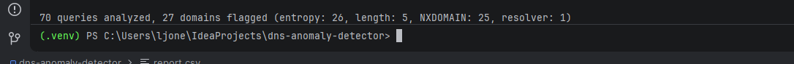
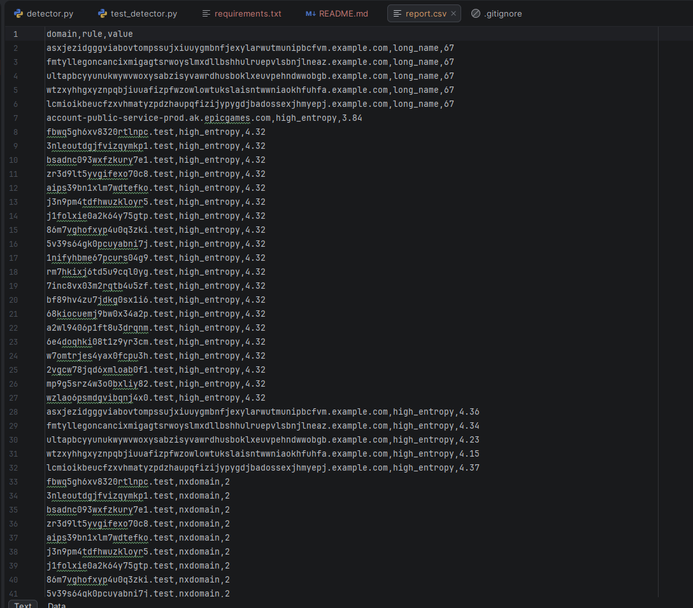

# DNS Anomaly Detector

A Python command-line tool that reads a packet capture (`.pcap` / `.pcapng`), pulls out every DNS lookup, and flags the ones that look like DNS tunneling, malware using a domain generation algorithm (DGA), or traffic going to a DNS server you don't use. It writes the findings to a CSV report.

Built with Python, [Scapy](https://scapy.net/), and Wireshark.

## Detection rules

| Rule | What it flags | Why it matters |
|---|---|---|
| **Length** | Full domain names longer than 50 characters | **DNS tunneling.** Attackers can hide stolen data or command-and-control traffic inside long subdomains, because DNS is rarely blocked. Normal names are usually short. |
| **Entropy** | Domains whose first label has a Shannon entropy above 3.5 | **DGA malware.** Some malware generates thousands of random-looking domains (like `x7kq9zp2mw4t.com`) to find its control server. Random strings score higher than real words. |
| **NXDOMAIN** | Failed lookups, once a capture has 10 or more | **DGA malware again.** Most generated domains aren't registered, so a burst of failed lookups is a strong sign. One failure is normal; dozens of different ones are not. |
| **Resolver** | Queries sent to a DNS server that isn't on your list | **Rogue resolvers.** Malware sometimes hardcodes its own DNS server (like `8.8.8.8`) to get around your network's filtering, and DNS hijacking points devices at an attacker's server. |

### How the entropy score works

For each character in the label, take `p = count / length`, add up `p * log2(p)`, and multiply the total by -1. Repeated letters lower the score; many different characters raise it.

| String | Entropy |
|---|---|
| `google` | 1.92 |
| `youtube` | 2.52 |
| `x7kq9zp2mw4t` | 3.58 |

## Installation

Requires Python 3 and Scapy.

```powershell
git clone https://github.com/Lukej2006/dns-anomaly-detector.git
cd dns-anomaly-detector
python -m venv .venv
.venv\Scripts\activate
pip install -r requirements.txt
```

Before running it on your own network, open `detector.py` and replace the addresses in `EXPECTED_DNS_SERVERS` with your own DNS servers. On Windows, `ipconfig /all` lists them under **DNS Servers**.

## Usage

```powershell
python detector.py captures\suspicious.pcapng --output report.csv
```

| Option | Default | Description |
|---|---|---|
| `pcap` | (required) | Path to a `.pcap` or `.pcapng` file |
| `--output` | none | Save findings to this CSV file |
| `--entropy` | 3.5 | Flag first labels with entropy above this |
| `--length` | 50 | Flag domain names longer than this |

### Capturing your own traffic

1. In Wireshark, enter `port 53` in the capture filter box before starting the capture.
2. Browse or run your test, then stop the capture.
3. Save it as `.pcapng` in the `captures` folder (ignored by Git).

## Sample output

From `suspicious.pcapng`, a capture of generated test traffic: 20 random `.test` lookups, 5 very long `.example.com` lookups, and one lookup sent to `8.8.8.8`.

```
Findings: 57
  [long_name] asxjezidgggviabovtompssujxiuuygmbnfjexylarwutmunipbcfvm.example.com (67)
  [long_name] fmtyllegoncancixmigagtsrwoyslmxdllbshhulruepvlsbnjlneaz.example.com (67)
  ...
  [high_entropy] account-public-service-prod.ak.epicgames.com (3.84)
  [high_entropy] fbwq5gh6xv8320rtlnpc.test (4.32)
  [high_entropy] 3nleoutdgjfvizqymkp1.test (4.32)
  ...
  [high_entropy] asxjezidgggviabovtompssujxiuuygmbnfjexylarwutmunipbcfvm.example.com (4.36)
  ...
  [nxdomain] fbwq5gh6xv8320rtlnpc.test (2)
  [nxdomain] 3nleoutdgjfvizqymkp1.test (2)
  ...
  [unexpected_server] google.com (8.8.8.8)

70 queries analyzed, 27 domains flagged (entropy: 26, length: 5, NXDOMAIN: 25, resolver: 1)
```
The epicgames.com line is a false positive: a real background lookup from the Epic Games launcher that happened during the capture.




## Results

| Capture | Queries | Domains flagged | Notes |
|---|---|---|---|
| `normal.pcapng` (everyday browsing) | 685 | 7 | All 7 are false positives |
| `suspicious.pcapng` (generated test traffic) | 70 | 27 | All 26 generated lookups caught, plus 1 background lookup |

Raising the thresholds to `--entropy 3.8 --length 60` cut false positives on the normal capture from 7 to 3. At those settings, the suspicious capture still flagged all 26 generated lookups

## Testing

```powershell
python -m unittest -v
```

The tests in `test_detector.py` check the entropy function on known strings and confirm that the length and entropy rules flag the right domains.

## Troubleshooting log

**`FileNotFoundError: captures/normal.pcapng`**
The path is relative to the folder the script runs from, and the `captures` folder was empty. Fixed by putting the capture in `captures\` inside the project.

**IntelliJ shows "Cannot find reference 'DNS' in 'scapy.all'"**
Scapy creates those names while the program runs, so the editor can't see them. The code ran fine. Importing directly with `from scapy.layers.dns import DNS, DNSQR` removed the warning.

**DNS traffic over IPv6**
Windows sent its DNS queries to the ISP's IPv6 DNS servers, not IPv4 ones. The resolver rule had to read the destination from either the `IP` or `IPv6` layer.

**The NXDOMAIN rule never fired on test traffic**
The first version flagged a domain only after 3 failed lookups of that same name. Windows looks up each name twice (an IPv4 `A` record and an IPv6 `AAAA` record), so each random name failed exactly twice and nothing was flagged. Changed the rule to count failed lookups across the whole capture, which also matches how DGA malware behaves: many different names, each failing once or twice.

**PowerShell `op_Addition` error when generating test traffic**
A typo: `(97.122)` instead of `(97..122)`. One dot makes a single decimal number; two dots make the range of character codes.

**Unfiltered capture would cause false alerts**
Without the `port 53` capture filter, Wireshark also recorded mDNS traffic on port 5353. Scapy decodes mDNS as DNS, so its multicast addresses (`224.0.0.251`, `ff02::fb`) would have been flagged as unexpected DNS servers. Using the capture filter fixed it.

**Run button fails with "the following arguments are required: pcap"**
After adding `argparse`, the script needs a file path. In IntelliJ, set it once under **Run → Edit Configurations → Script parameters**.

## Limitations

- **Fixed thresholds produce false positives.** On normal browsing, the entropy rule flagged long hostnames built from real words (internal API and launcher hostnames from large companies) and tracking or bot-detection subdomains that contain random IDs. Entropy rises with length and character variety, not just randomness.
- **Short random names slip through.** A label with fewer than 12 characters can never score above 3.5, even if it's completely random.
- **It can't see encrypted DNS.** Lookups made over DNS-over-HTTPS or DNS-over-TLS don't appear on port 53.
- **It only analyzes port 53 traffic**, from saved capture files.
- **The expected DNS servers are hardcoded** and have to be edited for each network.

## Next steps

- Live capture instead of saved files
- An allowlist for known CDN and tracking domains to cut false positives
- Replace fixed thresholds with a machine learning model trained on normal and malicious traffic
- Command-line options for the DNS server list and the NXDOMAIN threshold

## Project structure

```
dns-anomaly-detector/
├── detector.py          # The tool
├── test_detector.py     # Unit tests
├── requirements.txt
├── README.md
└── captures/            # Your .pcapng files (not committed)
```